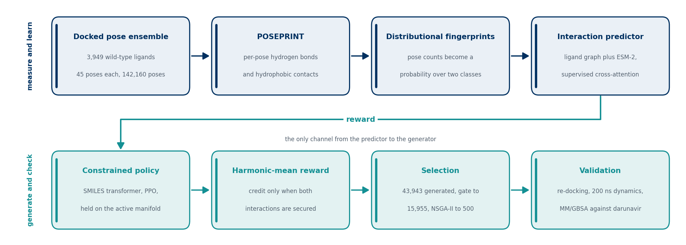

<p align="center">
  
</p>

<p align="center">
  <a href="https://doi.org/10.5281/zenodo.23982077"></a>
  <a href="LICENSE"></a>
  
</p>

Inference code for **CLINCH**, an interaction-resolved de novo design pipeline for
HIV-1 protease inhibitors. CLINCH is a word, not an acronym. It refers to the
harmonic-mean reward, which rewards a molecule only when it secures the hydrogen-bond
and the hydrophobic engagement at the same time.

This repository holds the two things needed to reproduce the predictions in the paper.

1. **Interaction prediction.** Score any ligand against the target and get the
   probability that the complex forms at least one hydrogen bond and the probability
   that it forms seven or more hydrophobic contacts, together with an ensemble spread.
   The released weights are the ten-model deployment ensemble, the same proxy the
   reward queried during reinforcement learning.
2. **Molecule generation.** Sample from the reinforcement-learning policy that produced
   the candidate library, and optionally score what comes out with the predictor.

Training code, the docking toolkit and the selection stage are not included here. This
repository is the inference path only.

<p align="center">
  
</p>

<p align="center"><sub>
The upper row builds and learns the interaction signal. The lower row generates
molecules from it and checks them. The reward is the only channel between the two, which
is why the constraints that keep the policy inside the predictor's competence sit on the
generator side.
</sub></p>

---

## What the model predicts

Interaction labels are not read off a single docking pose. Each ligand is docked into a
45-pose ensemble, per-pose hydrogen-bond and hydrophobic contact counts are extracted,
and the counts are turned into a probability over two classes. The predictor learns that
distribution, which is why its outputs are probabilities rather than a binary call.

| head | class 0 | class 1 |
| --- | --- | --- |
| `hbond` | no hydrogen bond | one or more |
| `hydrophobic` | six or fewer contacts | seven or more |

The predictor has a ligand graph encoder, a frozen ESM-2 protein encoder with per-residue
physicochemical features, and one cross-attention module per interaction type whose
attention is supervised against the docking contact residues.

---

## Install

PyTorch first, matched to your CUDA version, from <https://pytorch.org>. Then

```bash
pip install -r requirements.txt
```

`torch-geometric` sometimes needs its companion wheels. If the import fails, follow the
install notes at <https://pytorch-geometric.readthedocs.io>.

A GPU is strongly recommended. Sampling is autoregressive and re-runs the transformer at
every token, so on a CPU expect roughly one molecule per second. On a GPU it is orders of
magnitude faster. Interaction prediction on a CPU is workable for a few hundred ligands
and painful beyond that, because the protein encoder is a 650M-parameter model.

---

## Weights

The weights are archived on Zenodo under
[10.5281/zenodo.23982077](https://doi.org/10.5281/zenodo.23982077). They are not in this
repository because of their size. Download them and lay them out exactly as below.
`checkpoints/README.md` gives the detail.

```
checkpoints/
├── dti_ensemble/
│   ├── best_params.json
│   ├── model_0/best_model.pt
│   ├── ...                     <- ten members, model_0 through model_9
│   └── model_9/best_model.pt
└── generator/
    ├── best_model.pt
    └── vocab.json          <- already in the repository
```

The first run downloads `facebook/esm2_t33_650M_UR50D` from the Hugging Face hub, about
2.6 GB. Set `HF_HOME` if you want it cached somewhere specific.

---

## Interaction prediction

```bash
python predict_dti.py --input examples/ligands.csv --output preds.csv
```

The input is a CSV with a `smiles` or `ligand_smiles` column. A `protein_sequence`
column is optional. Without it the wild-type HIV-1 protease homodimer is used, which is
the target the released weights were trained on.

```bash
python predict_dti.py \
    --input my_ligands.csv \
    --ensemble_dir checkpoints/dti_ensemble \
    --device cuda --batch_size 32 \
    --output preds.csv
```

Output columns

| column | meaning |
| --- | --- |
| `prob_hbond_0`, `prob_hbond_1` | median class probabilities over the ensemble |
| `prob_hydrophobic_0`, `prob_hydrophobic_1` | the same for hydrophobic contacts |
| `unc_hbond`, `unc_hydrophobic` | interquartile range of the class-1 probability across members |
| `std_hbond`, `std_hydrophobic` | standard deviation of the same quantity |
| `n_models_hbond`, `n_models_hydrophobic` | how many members contributed |

The spread is reported as an interquartile range rather than a standard deviation
because one outlying member cannot dominate it. This is the same quantity the
reinforcement-learning reward used as its uncertainty discount, so numbers here line up
with the training runs.

Members are loaded one at a time and released, so peak memory is one model, not ten.

Two ensemble configurations appear in the paper and they are not interchangeable. The
twenty-five model configuration, five scaffold-grouped folds by five seeds, exists to
measure generalisation and reports out-of-fold metrics. The ten-model deployment
ensemble is trained on all wild-type data, holds out nothing, and is the proxy that
scored molecules during generation. The weights released here are the deployment
ensemble, so use the out-of-fold numbers in the paper when you want a generalisation
estimate, not predictions from these weights on the training ligands.

---

## Generation

```bash
python generate.py --n 1000 --output generated.csv
```

```bash
python generate.py \
    --checkpoint checkpoints/generator/best_model.pt \
    --n 10000 --batch_size 500 --temperature 1.0 \
    --device cuda --output pool.csv --report pool_stats.json
```

The script samples, drops anything RDKit cannot parse, canonicalises and removes exact
duplicates. `--report` writes the validity and uniqueness counts to JSON. Add `--score`
to pass the survivors through the interaction ensemble in the same run.

`--temperature 1.0` is the deployment setting used for the paper. Lower values make the
policy greedier and less diverse.

For reference, the released policy profiled on 10,000 samples at the deployment
temperature gives 94.09% validity, 68.57% uniqueness and 100% novelty against the
training set, with a normalised Bemis-Murcko scaffold entropy of 0.852 and a top-scaffold
fraction of 3.1%. Uniqueness is lower than for the model before reinforcement learning,
which is expected. PPO concentrates the policy on the high-reward region on purpose. The
acceptance thresholds inside the original profiling script were written for the
pre-reinforcement-learning checkpoint and should not be read as a verdict on the final
policy.

---

## Reproducing the candidate pool

The library in the paper came from this policy. Sampling under permissive drug-like
filters, then removing invalid strings and exact duplicates, left 43,943 molecules. A
data-driven gate on predicted probabilities and physicochemical properties reduced that
to 15,955, and NSGA-II with a per-cluster cap selected 500 for validation. The gate and
the selection stage are not part of this repository.

Sampling is stochastic. `--seed` fixes the torch seed, so a given seed, device and batch
size reproduce the same draw, but results will not match across different hardware.

---

## Notes and limits

- The predictor was trained on wild-type HIV-1 protease only. It has not been tested on
  the resistance mutants, and nothing here should be read as a resistance model.
- Agreement between the predictor and docking was measured with the same docking engine
  and contact definition that produced the training labels, so it is a consistency check
  rather than an independent one.
- The policy drives the predictor past the range the known actives occupy. Under
  out-of-fold prediction only 1.9% of the actives clear both selection thresholds against
  68.6% of the generated pool. Treat high predicted probabilities on generated molecules
  as a ranking signal, not as a calibrated probability.
- `best_params.json` must be the file saved with the ensemble you are loading. The
  architecture is rebuilt from it, and configurations from different tuning runs
  disagree on `hidden_size`, so a mismatched file will not load. The error message
  names the parameter file it was building from.
- No wet-lab validation has been carried out on any molecule produced by this code.

---

## Citation

The code and the weights are archived at
[10.5281/zenodo.23982077](https://doi.org/10.5281/zenodo.23982077).

```bibtex
@software{sayyah_clinch,
  author  = {Sayyah, Ehsan and Tunç, Hüseyin and Durdağı, Serdar},
  title   = {CLINCH, interaction-resolved de novo design for HIV-1 protease},
  year    = {2026},
  doi     = {10.5281/zenodo.23982077},
  url     = {https://github.com/ehsansyh/CLINCH}
}
```

A reference to the paper will be added when it has its own DOI.

## Licence

MIT, see [LICENSE](LICENSE). The weights are released under the same terms.
